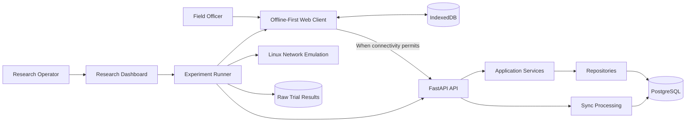

# OfflineLink Zambia — System Architecture

**Status:** Stage 0 baseline  
**Version:** 0.1  
**Date:** 2026-11-07

## 1. Architectural goal

The architecture separates the offline-capable field application, the central API and database, and the research/experimental tooling. The synchronization methods are implemented as distinct strategies that operate under shared correctness and measurement rules.

This document is the architectural baseline for implementation prompts. Generated code must follow it unless a reviewed decision changes it.

## 2. Logical components

### 2.1 Field client
- React and TypeScript user interface.
- Agricultural record features: farmers, farms, crops and observations.
- IndexedDB persistence.
- Local operation queue.
- Synchronization client and status presentation.
- Service-worker/PWA support for application availability, where implemented.

### 2.2 API server
- FastAPI application.
- API routes and request/response schemas.
- Application services.
- Repository/data-access layer.
- Synchronization processing.
- Configuration and database lifecycle.

### 2.3 Central persistence
- PostgreSQL.
- Versioned schema migrations.
- Persistent agricultural records.
- Operation/idempotency records and synchronization metadata.
- Experiment metadata and results, subject to the final research data model.

### 2.4 Research and experiment tooling
- Synthetic dataset and workload generation.
- Workload definitions.
- Network profile definitions.
- Trial runner.
- Traffic and application-level measurement.
- Correctness verification.
- Raw-result storage and analysis scripts.
- Research dashboard and export.

## 3. System context

The diagram is logical. The exact process boundaries and execution arrangement will be specified during implementation.

## 4. Backend layering

Expected responsibilities:

- `backend/app/api/`: HTTP routes and API composition.
- `backend/app/core/`: configuration, logging, shared infrastructure and application setup.
- `backend/app/models/`: persistence models.
- `backend/app/schemas/`: API and validation schemas.
- `backend/app/repositories/`: database access and persistence queries.
- `backend/app/services/`: application/business workflows.
- `backend/app/synchronization/`: synchronization strategies, operation processing, retry/idempotency behavior and verification support.
- `backend/migrations/`: versioned database migrations.
- `backend/tests/`: backend unit and integration tests.

Routes should not contain substantial business logic. Services should not duplicate repository SQL. Synchronization strategy code should not bypass the agreed operation and correctness model.

## 5. Frontend layering

Expected responsibilities:

- `frontend/src/app/`: application bootstrap, routing and top-level composition.
- `frontend/src/components/`: reusable UI components.
- `frontend/src/db/`: IndexedDB setup, schema and persistence primitives.
- `frontend/src/features/farmers/`: farmer feature.
- `frontend/src/features/farms/`: farm feature.
- `frontend/src/features/crops/`: crop feature.
- `frontend/src/features/observations/`: observation feature.
- `frontend/src/features/synchronization/`: local queue, synchronization client, status and method-specific behavior.
- `frontend/src/services/`: shared API/network services.
- `frontend/src/styles/`: application styling.
- `frontend/tests/`: frontend tests.

UI components should not directly implement database transaction logic. IndexedDB access should be centralized in the database/data-access layer. API payloads must conform to `docs/api-contract.md`.

## 6. Synchronization architecture

Two strategies are required:

1. **Full-record synchronization:** transmit the complete current record for each queued logical edit, according to the precise protocol definition.
2. **Change-log synchronization:** transmit individual change entries according to the precise protocol definition.

Both strategies must:
- use the same logical workload;
- preserve operation identity;
- apply the same retry and duplicate-prevention policy;
- use the same transport and verification rules;
- expose comparable measurements;
- be tested against the same correctness scenarios.

Strategy-specific serialization and transmission must remain separate from shared operation identity, retry policy, acknowledgement handling and trial verification.

## 7. Research execution architecture

A trial is a controlled execution with recorded metadata. At minimum, a trial record should identify:
- trial ID;
- synchronization method;
- workload ID and workload parameters;
- network profile ID and parameters;
- software revision;
- configuration version;
- start and end timestamps;
- operation count;
- outcome and failure details;
- metric values;
- raw evidence locations;
- final-state verification result.

The research dashboard is a control/observation interface. It must not introduce unrecorded changes to the workload or network profile during a trial.

## 8. Data flow

### Field operation
1. User creates or updates an agricultural record.
2. Client validates the input.
3. Client persists the record locally.
4. Client creates or updates the local synchronization operation according to the selected protocol.
5. UI reflects local persistence and pending synchronization status.

### Synchronization
1. Client selects eligible pending operations.
2. Client transmits according to the configured synchronization strategy.
3. Server validates and processes operation identity.
4. Server persists accepted effects and operation processing metadata transactionally where appropriate.
5. Server returns an acknowledgement/receipt.
6. Client updates operation status.
7. Trial verifier checks queue completion and expected final server state.

Exact endpoint and payload behavior is defined in `api-contract.md` and `sync-protocol.md`.

## 9. Reliability boundaries

- Local persistence is the source of truth for unsynchronized client work.
- Server persistence is the source of truth for accepted central records.
- A client must not mark an operation complete merely because it attempted transmission.
- An interrupted request may have been processed by the server; retry safety depends on stable operation identity and server-side duplicate prevention.
- Trial completion is based on verified outcome, not only transport response.

## 10. Technology baseline

- Frontend: React + TypeScript.
- Local client storage: IndexedDB.
- Backend: Python + FastAPI.
- Central database: PostgreSQL.
- Migrations: versioned migration tool to be selected/configured during foundation stage.
- Network emulation: Linux network namespaces and `tc/netem`.
- Backend testing: pytest.
- Frontend/browser testing: Playwright and/or suitable unit test tooling, to be finalized in Stage 1.
- Development host: Linux Mint.

## 11. Security and privacy

- Use synthetic research records.
- Keep credentials out of source code.
- Validate inputs on both client and server.
- Restrict research controls from ordinary field-user flows where appropriate.
- Document security-relevant decisions in `SECURITY.md` and decision records.
- Do not add authentication complexity unless required by the approved scope or deployment context; any decision must be documented.

## 12. Architecture decision process

A material architecture change must:
1. describe the current decision;
2. explain the problem or evidence prompting change;
3. identify affected components and contracts;
4. assess research validity and compatibility;
5. be approved before implementation;
6. be recorded under `docs/decisions/`.

## 13. Implementation principle

Build incrementally. Each layer must run and be tested before dependent layers are added. Qwen owns backend implementation; DeepSeek owns frontend implementation; both follow the same contracts. Integration and validation occur against the actual repository.
