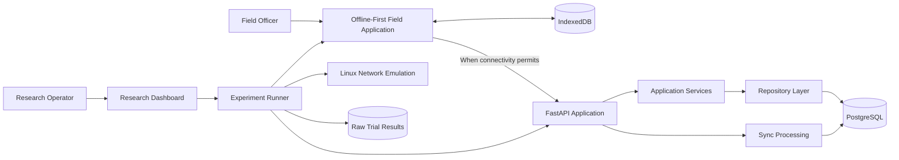

# OfflineLink Zambia — System Architecture Specification

**Project:** OfflineLink Zambia  
**Research title:** Design and Experimental Evaluation of an Offline-First Agricultural Data Collection Application for Unstable and Low-Bandwidth Network Conditions in Zambia  
**Document type:** System Architecture Specification  
**Status:** Approved architectural direction; detailed design under refinement  
**Version:** 0.2  
**Date:** 11 November 2026

---

## 1. Introduction

### 1.1 Purpose

This document defines the planned system architecture for OfflineLink Zambia.

It describes the logical components, their responsibilities, interactions, data flows, technology choices and architectural boundaries that will guide implementation.

The architecture is designed to support two principal requirements:

1. Reliable offline-first agricultural data collection.
2. Controlled experimental comparison of full-record and change-log synchronization.

This document establishes the shared architectural reference for frontend development, backend development, integration and research tooling.

It describes the intended system design. It does not claim that the components or functionality have already been implemented.

### 1.2 Architectural Objectives

The architecture must:

- Support agricultural data collection without continuous internet connectivity.
- Preserve locally captured records and pending operations.
- Synchronize local changes with a central server.
- Support two independently measurable synchronization strategies.
- Apply shared correctness and duplicate-prevention rules.
- Support deterministic research workloads and controlled network experiments.
- Separate application responsibilities to support testing and maintainability.
- Preserve experimental evidence and reproducibility.

---

## 2. Architectural Overview

The system is organized into three principal architectural areas:

1. **Field Application:** An offline-first web application used by agricultural field officers.
2. **Backend and Central Persistence:** An API server responsible for validation, application services, synchronization processing and persistent storage.
3. **Research and Experimental Environment:** Research tooling responsible for synthetic data, workload configuration, network emulation, trial execution, measurement and result analysis.

The synchronization mechanisms form a distinct part of the architecture. They share common operation identity, reliability, acknowledgement and verification rules while retaining separate data representations.

### 2.1 Logical Architecture

The following diagram represents the intended logical system structure.

The diagram describes logical responsibilities and interactions. Exact process boundaries, deployment arrangements and research-control interfaces will be specified during implementation planning.

---

## 3. Architectural Components

### 3.1 Field Application

The field application provides the user interface for agricultural field officers.

Its primary responsibility is to allow supported record operations to take place locally, regardless of whether the central API is reachable.

**Planned responsibilities:**

- Present the agricultural record-management interface.
- Support farmer, farm, crop and observation records.
- Validate data before local persistence.
- Persist supported records using IndexedDB.
- Maintain pending synchronization operations.
- Initiate synchronization when connectivity permits.
- Display pending, in-progress, completed and failed synchronization states.
- Process server acknowledgements and receipts.
- Preserve pending work after interruptions.

**Technology direction:**

- React
- TypeScript
- IndexedDB
- Progressive Web Application and service-worker capabilities where required

The user interface must not directly implement database transaction logic. Data persistence and synchronization responsibilities must remain within their appropriate application layers.

### 3.2 Backend API Server

The backend provides the central application interface and coordinates application services.

**Planned responsibilities:**

- Expose the versioned application API.
- Validate incoming requests.
- Coordinate application workflows.
- Access persistent data through repositories.
- Process synchronization submissions.
- Enforce operation identity and duplicate-prevention rules.
- Generate processing acknowledgements or receipts.
- Support final-state verification.
- Provide application configuration, logging and database lifecycle management.

**Technology direction:**

- Python
- FastAPI
- PostgreSQL integration
- Versioned database migrations

The API layer should remain separate from business logic and database persistence operations.

### 3.3 Central Persistence

PostgreSQL is the planned central database.

It will provide persistent storage for:

- Farmer records.
- Farm records.
- Crop records.
- Observation records.
- Synchronization operation identity and processing metadata.
- Idempotency-related records.
- Experiment metadata and results, subject to the final research data model.

Database schema changes will be managed through a versioned migration workflow.

The final database schema must follow the approved agricultural data model and synchronization protocol.

### 3.4 Research and Experimental Environment

The research environment provides the facilities needed to execute and evaluate controlled synchronization experiments.

**Planned responsibilities:**

- Generate deterministic synthetic datasets.
- Define logical operation workloads.
- Configure network profiles.
- Execute experimental trials.
- Coordinate synchronization method selection.
- Capture application-level measurements.
- Capture total network traffic using the defined measurement procedure.
- Verify expected final server state.
- Store raw trial results.
- Calculate and analyse derived metrics.
- Present experimental status and results.
- Export machine-readable research data.

**Technology and tool direction:**

- Python-based research tooling.
- Linux network namespaces.
- Linux `tc/netem`.
- Automated test and verification utilities.
- Research dashboard and export facilities.

The research dashboard is a control and observation interface. It must not introduce unrecorded changes to workloads or network conditions during a trial.

---

## 4. Backend Architectural Structure

The backend will use a layered structure that separates HTTP handling, application services, persistence and synchronization responsibilities.

### 4.1 API Layer

**Planned directory:** `backend/app/api/`

Responsibilities:

- Define API routes.
- Handle request and response composition.
- Apply API-level dependencies.
- Coordinate calls to application services.
- Return documented response and error structures.

Routes should not contain substantial business logic or direct database query implementations.

### 4.2 Core Infrastructure

**Planned directory:** `backend/app/core/`

Responsibilities:

- Application configuration.
- Environment settings.
- Logging.
- Shared infrastructure.
- Database lifecycle configuration.
- Common application setup.

Secrets and environment-specific configuration must be managed outside committed source code.

### 4.3 Persistence Models

**Planned directory:** `backend/app/models/`

Responsibilities:

- Define persistent entity representations.
- Define database relationships.
- Represent synchronization and experiment-related persistence structures where approved.

The models must conform to the approved data dictionary and database design.

### 4.4 API and Validation Schemas

**Planned directory:** `backend/app/schemas/`

Responsibilities:

- Define API request structures.
- Define API response structures.
- Validate incoming data.
- Define synchronization payload structures.
- Maintain consistent API conventions.

Frontend types and backend schemas must follow the same API contract.

### 4.5 Repository Layer

**Planned directory:** `backend/app/repositories/`

Responsibilities:

- Perform database access.
- Implement persistence queries.
- Retrieve and update records.
- Provide persistence operations to application services.

Repositories should not independently implement the complete application workflow.

### 4.6 Application Services

**Planned directory:** `backend/app/services/`

Responsibilities:

- Coordinate application workflows.
- Apply business rules.
- Coordinate repositories and other application components.
- Maintain separation between HTTP handling and persistence operations.

### 4.7 Synchronization Layer

**Planned directory:** `backend/app/synchronization/`

Responsibilities:

- Implement full-record synchronization processing.
- Implement change-log synchronization processing.
- Apply shared operation identity rules.
- Apply duplicate-prevention and idempotency rules.
- Coordinate retry-related processing.
- Produce processing receipts.
- Support final-state verification.
- Record synchronization metadata.

Synchronization strategies must remain separate from shared correctness and operation-processing responsibilities.

### 4.8 Database Migrations

**Planned directory:** `backend/migrations/`

Responsibilities:

- Maintain versioned database schema changes.
- Support consistent database setup.
- Track schema evolution.
- Support repeatable test and development environments.

The migration tool and configuration remain to be finalized during the foundation implementation stage.

### 4.9 Backend Tests

**Planned directory:** `backend/tests/`

Responsibilities:

- Backend unit tests.
- API integration tests.
- Validation tests.
- Persistence tests.
- Synchronization correctness tests.
- Duplicate-delivery and retry tests.

---

## 5. Frontend Architectural Structure

The frontend will use a feature-oriented structure supported by shared application, persistence and service layers.

### 5.1 Application Layer

**Planned directory:** `frontend/src/app/`

Responsibilities:

- Application bootstrap.
- Routing.
- Top-level application composition.
- Shared application configuration.

### 5.2 Reusable Components

**Planned directory:** `frontend/src/components/`

Responsibilities:

- Reusable interface components.
- Shared presentation elements.
- Common UI behavior.

### 5.3 Local Database Layer

**Planned directory:** `frontend/src/db/`

Responsibilities:

- IndexedDB initialization.
- Local database schema.
- Local persistence operations.
- Local transaction handling.
- Data-access primitives.

IndexedDB access should be centralized rather than independently implemented inside individual UI components.

### 5.4 Agricultural Features

The following feature areas are planned:

| Directory | Responsibility |
|---|---|
| `frontend/src/features/farmers/` | Farmer record management |
| `frontend/src/features/farms/` | Farm record management |
| `frontend/src/features/crops/` | Crop record management |
| `frontend/src/features/observations/` | Agricultural observation management |

Each feature must follow the approved data model and local persistence rules.

### 5.5 Synchronization Feature

**Planned directory:** `frontend/src/features/synchronization/`

Responsibilities:

- Maintain the local operation queue.
- Identify eligible pending operations.
- Coordinate synchronization attempts.
- Support the selected synchronization strategy.
- Handle processing receipts.
- Update operation status.
- Preserve pending work after interruptions.
- Support the client-side verification workflow.

The synchronization feature must not bypass the shared operation identity and correctness rules.

### 5.6 Shared Services

**Planned directory:** `frontend/src/services/`

Responsibilities:

- Shared API communication.
- Network-related services.
- Common application service logic.
- API contract integration.

### 5.7 Styling

**Planned directory:** `frontend/src/styles/`

Responsibilities:

- Shared application styles.
- Layout and presentation consistency.
- Reusable styling definitions.

### 5.8 Frontend Tests

**Planned directory:** `frontend/tests/`

Responsibilities:

- Component tests.
- Feature behavior tests.
- Local persistence tests.
- Synchronization client tests.
- Browser and end-to-end tests.

---

## 6. Synchronization Architecture

Synchronization is a central research component of OfflineLink Zambia.

The architecture must support two distinct synchronization strategies operating under common reliability and correctness requirements.

### 6.1 Full-Record Synchronization

Full-record synchronization transmits the complete current record for each queued logical edit according to the approved workload semantics.

The strategy must:

- Preserve the stable operation ID.
- Represent the complete record in the synchronization payload.
- Record logical operations separately from transmission attempts.
- Support duplicate prevention.
- Retain sufficient information for payload and traffic measurements.
- Avoid silently collapsing logical edits unless the workload explicitly defines that behavior.

### 6.2 Change-Log Synchronization

Change-log synchronization transmits individual change entries representing logical edits.

The strategy must:

- Assign each logical change a stable operation ID.
- Preserve the defined operation ordering.
- Represent changes according to the approved protocol.
- Prevent repeated delivery from applying the same logical operation twice.
- Retain sufficient information for measurement and verification.

### 6.3 Shared Synchronization Responsibilities

Both strategies must use:

- Equivalent logical workloads.
- Stable operation identity.
- Equivalent ordering requirements.
- The same transport.
- The same retry policy.
- The same duplicate-prevention requirements.
- Processing acknowledgements or receipts.
- The same final-state verification rules.
- Comparable measurement procedures.

Strategy-specific payload representation and serialization must remain distinct from shared operation identity, retry handling, acknowledgement processing and trial verification.

### 6.4 Operation Processing Flow

The intended synchronization sequence is:

1. The client identifies eligible pending operations.
2. The selected synchronization strategy constructs the appropriate payload.
3. The client transmits the operation or batch to the central API.
4. The server validates the submitted data.
5. The server evaluates operation identity and duplicate status.
6. Accepted operations are processed and their effects and processing metadata are persisted.
7. The server returns processing acknowledgement or receipt information.
8. The client updates local operation status using the returned evidence.
9. The research verification process checks the pending queue and final server state.

The exact payload structures, receipt schema, transaction boundaries, retry parameters and batch behavior are governed by `sync-protocol.md` and must be finalized before synchronization implementation.

---

## 7. System Data Flow

### 7.1 Local Agricultural Record Operation

The intended local record workflow is:

1. A field officer creates or updates an agricultural record.
2. The client validates the submitted data.
3. The client persists the record locally.
4. The client creates a corresponding synchronization operation.
5. The local operation remains pending until successfully processed.
6. The user interface reflects the local record and synchronization status.

Local capture must not depend on the availability of the central API.

### 7.2 Synchronization Workflow

The intended synchronization workflow is:

1. Connectivity becomes available.
2. The client identifies eligible pending operations.
3. The selected synchronization method prepares the submission.
4. The API receives and validates the submission.
5. The server processes operation identity and duplicate-prevention rules.
6. Accepted effects and processing metadata are persisted.
7. The server returns an acknowledgement or receipt.
8. The client updates the corresponding local operation state.
9. Final-state verification determines whether the intended workload has been correctly processed.

An interrupted request may have been processed by the server even when the client did not receive the response. Stable operation identity and server-side duplicate prevention are therefore essential.

### 7.3 Research Trial Workflow

The intended experimental workflow is:

1. The research operator selects a synchronization method.
2. A deterministic synthetic dataset and workload are prepared.
3. The initial dataset and expected final state are established.
4. The network profile and trial configuration are recorded.
5. The trial is executed.
6. Application-level and network-level measurements are captured.
7. The final server state is verified.
8. Raw trial results and metadata are retained.
9. Derived metrics are calculated for analysis and comparison.

The trial configuration must remain controlled and recorded throughout execution.

---

## 8. Reliability and Data Integrity Boundaries

The architecture establishes the following reliability principles.

### 8.1 Local Data Responsibility

Local persistence is the source of truth for unsynchronized client work.

Pending operations must remain available until the applicable processing acknowledgement is received.

### 8.2 Central Data Responsibility

The central database is the source of truth for accepted server-side records.

Server-side processing must enforce the approved validation, operation identity and duplicate-prevention rules.

### 8.3 Operation Identity

Each logical operation must have a stable unique identifier that remains unchanged across retries.

Repeated delivery of the same operation must not create unintended duplicate effects.

### 8.4 Processing Acknowledgements

A client must not mark an operation complete merely because transmission was attempted or an HTTP response was received.

Processing receipts or equivalent contract-defined evidence must be used to establish operation processing.

### 8.5 Verified Completion

A trial is complete only when:

- All intended logical operations have been processed.
- No pending operations remain.
- The final server state matches the deterministic expected state.
- Processing receipts are consistent.
- No unintended duplicate effects are detected.

These conditions distinguish verified synchronization completion from successful network transmission.

---

## 9. Research and Experimental Architecture

### 9.1 Synthetic Data Generation

The research tooling must generate deterministic synthetic agricultural datasets.

The generated records must represent the approved agricultural entities and their relationships without using real farmer personal data.

### 9.2 Workload Generation

The research tooling must support the approved workload scenarios:

- Operations distributed across many records.
- Repeated edits to fewer records.

The logical workload must be equivalent between synchronization methods.

### 9.3 Network Emulation

Linux network namespaces and `tc/netem` will provide controlled network conditions.

The research tooling must associate each trial with its network profile and relevant configuration.

Network profile settings must be treated as experimental parameters, not direct claims about actual Zambian connectivity.

### 9.4 Measurement and Verification

The research environment must collect:

- Serialized request-body bytes.
- Total captured network traffic.
- Request and attempt counts.
- Verified synchronization time.
- Completion rate.
- Data-consistency results.
- Failure and interruption information.

Request-body bytes and total captured traffic must remain separate measurements.

### 9.5 Trial Metadata

Each trial should record at least:

- Unique trial ID.
- Synchronization method.
- Workload identifier and parameters.
- Logical operation count.
- Network profile and parameters.
- Software revision.
- Configuration and protocol version.
- Retry configuration.
- Batch configuration, if applicable.
- Start and end timestamps.
- Request-body bytes.
- Total captured traffic.
- Request and attempt counts.
- Completion rate.
- Verified synchronization time.
- Consistency result.
- Failure details.
- Raw evidence references.

### 9.6 Research Results

Raw trial results must be retained separately from derived analysis.

The research tooling must support documented machine-readable exports so that experimental results can be independently examined and reprocessed.

---

## 10. Technology Architecture

The initial technology direction is as follows.

| Component | Technology | Purpose |
|---|---|---|
| Frontend | React | User interface |
| Frontend language | TypeScript | Application logic and type definitions |
| Local storage | IndexedDB | Offline record and operation persistence |
| Backend | Python | Server-side application logic |
| API framework | FastAPI | HTTP API |
| Central database | PostgreSQL | Persistent central data |
| Network emulation | Linux namespaces and `tc/netem` | Controlled network conditions |
| Backend testing | pytest | Backend unit and integration tests |
| Frontend/browser testing | Playwright and/or suitable unit testing tools | Browser and frontend validation |
| Development host | Linux Mint | Initial development environment |

A versioned migration tool will be selected and configured during the foundation implementation stage.

Testing tool selection and detailed environment configuration will be documented before their respective implementation activities.

---

## 11. Security and Privacy Architecture

The system must follow these security and privacy principles:

- Experimental records must be synthetic.
- Credentials and secrets must not be embedded in source code.
- Environment-specific configuration must be managed outside committed source code.
- Client and server inputs must be validated.
- Research controls must be separated from ordinary field-user workflows where appropriate.
- Security-relevant decisions must be documented.
- Authentication complexity must not be introduced without a justified requirement or deployment need.

Security-related changes must be reviewed against the approved research scope and documented in `SECURITY.md` and relevant decision records.

---

## 12. Architecture Decision Management

Material architecture changes must be reviewed before implementation.

Each proposed change must:

1. Describe the current architectural decision.
2. Explain the problem or evidence prompting the change.
3. Identify affected components and contracts.
4. Assess research validity and compatibility implications.
5. Receive approval before implementation.
6. Be documented in `docs/decisions/`.

The architecture, API contract and synchronization protocol must remain consistent across frontend, backend and research tooling.

---

## 13. Implementation Principles

Implementation will proceed incrementally.

The following principles apply:

- Establish and verify the development foundation before dependent components are introduced.
- Develop backend and frontend components against shared contracts.
- Keep local persistence separate from user-interface presentation.
- Keep API routing separate from business logic.
- Keep database access within the persistence layer.
- Keep synchronization strategies separate from shared reliability rules.
- Test individual layers before integration.
- Validate behavior against the approved requirements.
- Preserve evidence of implementation and verification.

Planned development responsibilities:

- **Qwen:** Backend implementation.
- **DeepSeek:** Frontend implementation.
- **ChatGPT:** Architecture coordination, prompt preparation, integration review and validation support.

Generated code must be checked against the actual repository and the approved documentation.

---

## 14. Outstanding Architectural Decisions

The following details remain subject to further specification or approval:

- Exact agricultural data field types and validation constraints.
- Final database model and migration design.
- Exact synchronization request and response schemas.
- Receipt structure and idempotency retention behavior.
- Retry classification, limits and backoff policy.
- Batch size and partial acceptance behavior.
- Final-state verification implementation.
- Research dashboard process boundaries.
- Detailed network capture procedure.
- Final selection of supporting frontend and migration tools.

These open items must be resolved at the appropriate design stage before dependent components are implemented.

---

## 15. Document Status

This document establishes the approved logical architectural direction for OfflineLink Zambia.

The system components, responsibilities, technology direction, data flows and reliability boundaries described here are planned design specifications.

They must not be interpreted as evidence that the application, API, database or research tooling has already been implemented.

**Implementation status:** Not implemented.

**Related documents:**

- `requirements.md`
- `api-contract.md`
- `sync-protocol.md`
- `test-plan.md`
- `decisions/`

---

**OfflineLink Zambia — System Architecture Specification**

*An architecture designed around offline reliability, synchronization correctness and reproducible experimental evaluation.*